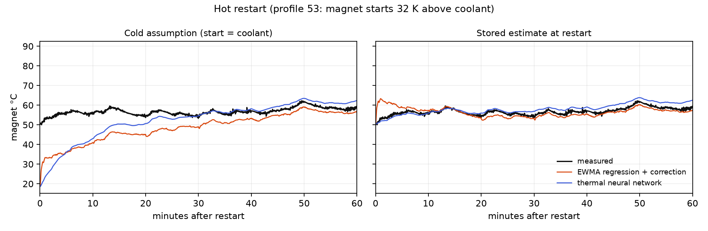

# E-motor virtual temperature sensor + engineering assistant

Estimating the rotor-magnet and stator temperatures of an electric-vehicle motor (PMSM) from signals a car can actually measure — and an LLM assistant that answers engineering questions by calling the model.

**Live demo:** _coming soon_ · **Case study:** [meetbabariya.github.io/work/emotor-virtual-sensor](https://meetbabariya.github.io)

| | This project | Best published model |
|---|---|---|
| Average error on unseen test cycles (MSE, 4 temperatures) | **1.50 K²** | 2.87 K² |
| Worst-case error | **5.73 K** | 6.02 K |
| Uses torque as an input | **no** (not measurable in a car) | yes |
| Assistant evaluation | **13 / 13** questions correct | — |

Published numbers: Kirchgässner, Wallscheid & Böcker, *Thermal neural networks*, Engineering Applications of AI (2023), Table III — same generalization cycles (60, 62, 74).

## Why it matters

Permanent magnets lose strength permanently above ~120–150 °C, but you cannot put a sensor on a rotor spinning at 6,000 rpm. Car makers therefore estimate the temperature (a *virtual sensor*). Better estimates let a motor run closer to its limit — more performance from less material.

## The finding the benchmark hides

All three official test cycles start with a cool motor. Real cars **restart hot**. In cycle 53 the magnet starts 32 °C above the coolant: a sensor that assumes a cold start is ~30 K wrong for ~40 minutes. Starting from the temperature stored at the last shutdown, the error is gone within ~3 minutes.



## How it works

1. **Load-history features.** Temperature responds to the last minutes-to-hours of losses, so currents/voltages are summarised as exponentially weighted means and standard deviations over 7–53 min. The history before a recording is padded as *motor off* (electrical signals = 0, temperatures = first reading).
2. **Ridge regression + start-of-run correction.** A known initial temperature removes the model's start bias, which then decays with a time constant chosen by cross-validation (≈15 min magnet, 5 min stator — the rotor is less directly cooled).
3. **Thermal Neural Network** (PyTorch). A lumped heat-flow network whose power losses and thermal conductances are small neural networks, integrated every 0.5 s from the initial temperature (architecture after the dataset authors; [reference code](https://github.com/wkirgsn/thermal-nn)).
4. **Ensemble.** The two models' errors are anti-correlated, so their mean (1.50 K²) beats both (2.09 / 2.70 K²).
5. **Assistant.** An LLM (Gemini free tier by default, Claude switchable) answers questions by calling six deterministic tools — cycle summaries, overheating search, hot-restart detection, what-if simulation, model card. Every number comes from code.

## Evaluation discipline

- Test cycles were scored once per final configuration. Feature, model and hyper-parameter choices used grouped cross-validation on training cycles (whole drive cycles held out) and a validation set that includes hot restarts.
- One early bug (EWMA warm-up: 11.2 → 3.8 K²) was found while inspecting test errors; all later choices moved to cross-validation.
- The assistant is graded by `src/eval_assistant.py`: 13 questions whose answers are computed from the data, checked for cycle ids, numbers within tolerance, required caveats and tool use. v1 scored 11/13: the LLM had to do arithmetic over 69 rows and missed two hot restarts — fixed by adding a tool, not by prompting. Two grader rules that rejected correct answers were widened and the stored answers re-graded (`reports/assistant_eval_v1.json` kept for comparison).

**What didn't work:** a plain GRU (2.79 K²) learned to ignore its initial state; gradient boosting lost to the linear model in CV; padding the pre-recording history with the first reading produced a 79 K error on a cycle that starts at 5,700 rpm.

**Limitations:** one motor on one test bench; three test cycles; what-if outside the recorded range is extrapolation; at a 100 °C threshold the sensor misses one cycle whose true peak is 102.1 °C, so a deployed system needs margin.

## Run it

```bash
python -m venv .venv && source .venv/bin/activate
pip install -r requirements.txt
cp .env.example .env            # add a free GEMINI_API_KEY for live assistant questions
streamlit run app.py            # demo uses artifacts/ (24 MB), no dataset download needed
```

Reproduce the models (needs the Kaggle dataset in `data/`):

```bash
kaggle datasets download -p data --unzip wkirgsn/electric-motor-temperature
python -m src.select_cv           # grouped CV model selection
python -m src.start_correction    # ridge + start correction, scored on test once
python -m src.tnn --seed 1 --lr 5e-3          # Thermal Neural Network
python -m src.compare             # head-to-head + ensemble choice on validation
python -m src.sensor              # package the deployable virtual sensor
python -m src.eval_assistant      # 13-question assistant evaluation
python -m src.build_demo_data     # compact artifacts for the app
```

## Repository

```
app.py                    Streamlit demo (overview, explorer, hot restart, what-if, assistant)
src/data.py               loading, splits, physics + EWMA features
src/select_cv.py          grouped cross-validation
src/start_correction.py   start-of-run bias correction
src/tnn.py                Thermal Neural Network (PyTorch)
src/compare.py            model comparison + ensemble selection
src/sensor.py             deployable VirtualSensor
src/tools.py              deterministic tools for the assistant
src/assistant.py          hand-written agent loop (Gemini / Claude)
src/eval_assistant.py     assistant evaluation + grader
artifacts/                compact data + model for the demo
reports/                  metrics, logs, figures
```

## Credits

Data: W. Kirchgässner, O. Wallscheid, J. Böcker — Paderborn University (LEA), *Electric Motor Temperature*, [Kaggle](https://www.kaggle.com/datasets/wkirgsn/electric-motor-temperature), CC-BY-SA-4.0. `artifacts/demo_data.parquet` is a derivative of this dataset (values rounded to 0.01, plus model estimates) and is shared under the same CC-BY-SA-4.0 licence.

Code © Meet Babariya, MIT licence. Built by [Meet Babariya](https://meetbabariya.github.io).
